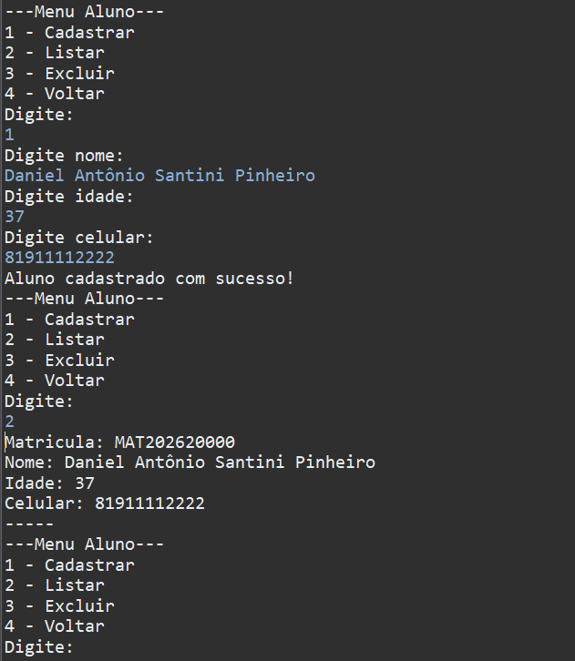
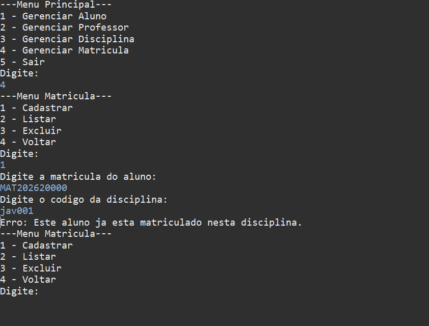
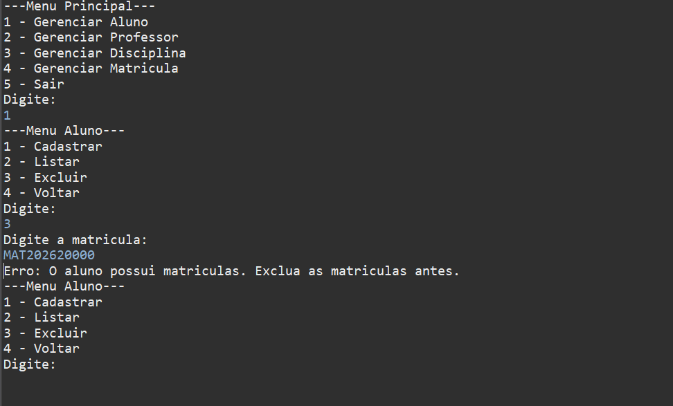
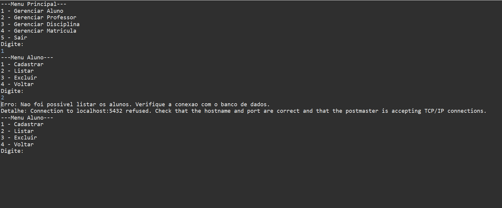

# Sistema Gerenciador Acadêmico

Sistema de console em Java para cadastrar alunos, professores e disciplinas e matricular alunos nas disciplinas, com os dados salvos em PostgreSQL.

Projeto de conclusão do módulo de Banco de Dados do curso **Desenvolvedor Full Stack em Java**, da **Fuctura Tecnologia**.

## Demonstração

**Cadastro com matrícula gerada pelo banco**



**Código padronizado e matrícula repetida bloqueada**



**Aluno com matrícula não pode ser excluído**



**O sistema continua rodando mesmo com o banco fora do ar**



## Tecnologias

- Java 21
- JDBC
- PostgreSQL
- Maven

## Funcionalidades

- Cadastrar, listar e excluir alunos, professores, disciplinas e matrículas.
- Matrícula do aluno gerada automaticamente pelo banco (ex.: `MAT202620000`).
- Data da matrícula preenchida automaticamente.
- Códigos digitados com espaços ou em minúsculas são padronizados (` jav001 ` vira `JAV001`).
- Mensagens claras para dados inválidos, sem fechar o programa.

## Pontos fortes

- **Organização em camadas:** cada pacote tem uma responsabilidade. O menu conversa com o usuário, o service valida as regras e o DAO acessa o banco.
- **Consultas seguras:** todas usam `PreparedStatement`, que evita SQL Injection.
- **Conexões sempre fechadas:** uso de `try-with-resources`.
- **Regras garantidas também pelo banco:** chaves primárias, chaves estrangeiras, `UNIQUE` e `CHECK`. Por exemplo, o banco impede matricular o mesmo aluno duas vezes na mesma disciplina.
- **Tratamento de erros:** se o banco estiver fora do ar ou um dado for inválido, o sistema mostra uma mensagem e volta ao menu.
- **Configuração separada do código:** os dados de conexão ficam em um arquivo próprio, fora do repositório. Para trocar de banco, não é preciso alterar nenhuma classe.
- **Sem código repetido nos menus:** os quatro menus de cadastro herdam de uma classe abstrata (`MenuCrud`), que concentra o laço do menu.

## Estrutura

```
src/main/java/br/com/fuctura
├── menu/            telas do console
├── service/         regras e validações
├── dao/             acesso ao banco
├── entity/          classes Aluno, Professor, Disciplina e Matricula
├── enums/           opções dos menus
├── util/            validações de texto
└── infrastructure/  conexão com o banco
```

## Como executar

Pré-requisitos: Java 21, Maven e PostgreSQL.

1. Clone o repositório:
   ```bash
   git clone https://github.com/dSantiniP/sistemaGerenciadorAcademico.git
   ```
2. Crie um banco no PostgreSQL e execute o arquivo `schema.sql`.
3. Em `src/main/resources`, copie `application.properties.example` para `application.properties` e preencha com os dados do seu banco.
4. Execute a classe `br.com.fuctura.Aplicacao`.

## O que estudei neste projeto

- Orientação a objetos: classes, encapsulamento, herança e classe abstrata.
- Acesso a banco com JDBC: `Connection`, `PreparedStatement` e `ResultSet`.
- Criação de tabelas e relacionamentos no PostgreSQL.
- Tratamento de exceções com `try-catch`.
- Validação de dados antes de gravar no banco.
- Uso de Git e GitHub para versionar e publicar o projeto.

## Próximos passos

- Adicionar a opção de editar registros.
- Criar testes automatizados com JUnit.
- Transformar o sistema em uma API com Spring Boot.

## Autor

**Daniel Santini**, estudante de Análise e Desenvolvimento de Sistemas, focado em desenvolvimento back-end com Java.

[LinkedIn](https://www.linkedin.com/in/danielsantinidev/)